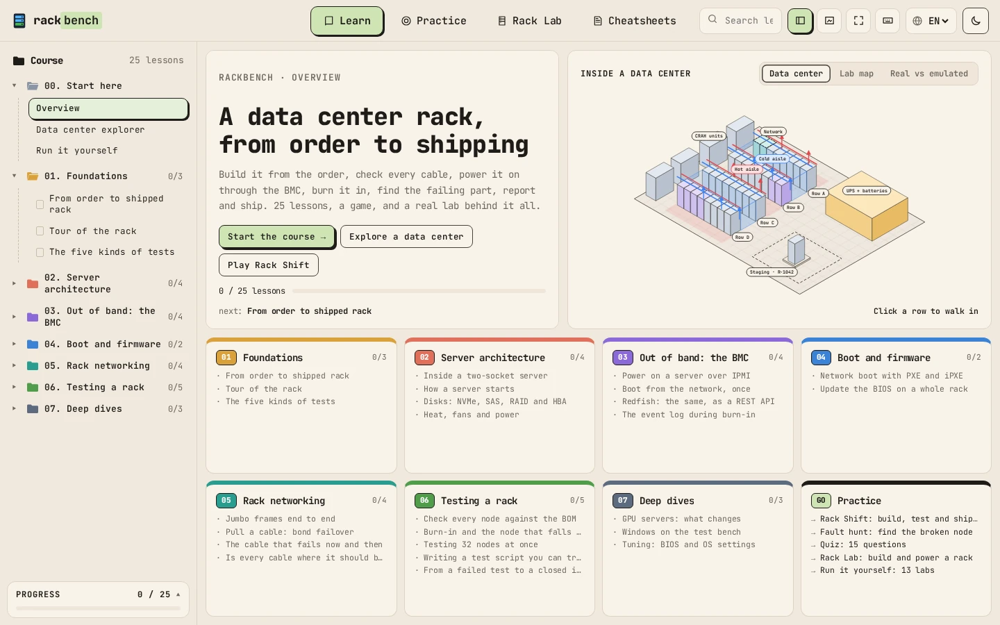
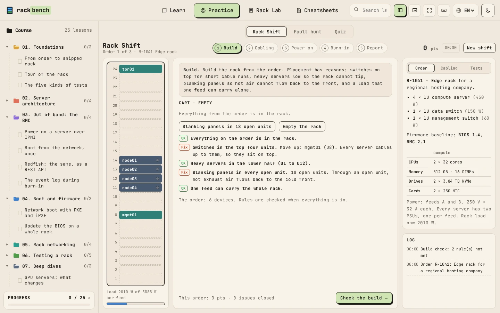
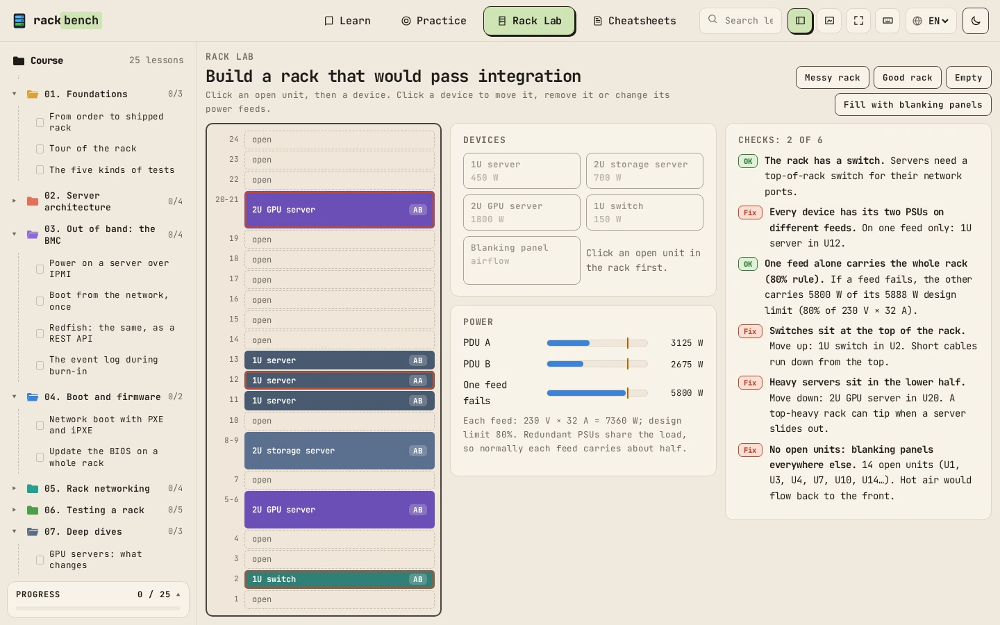
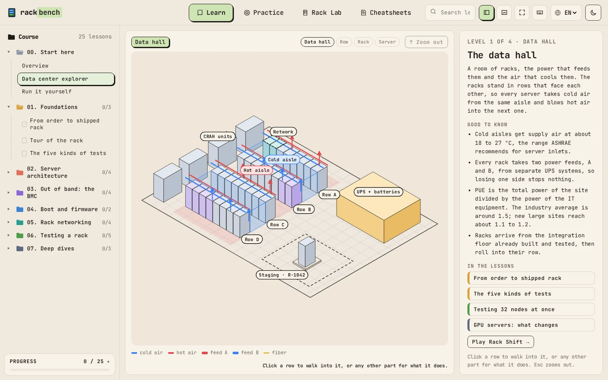
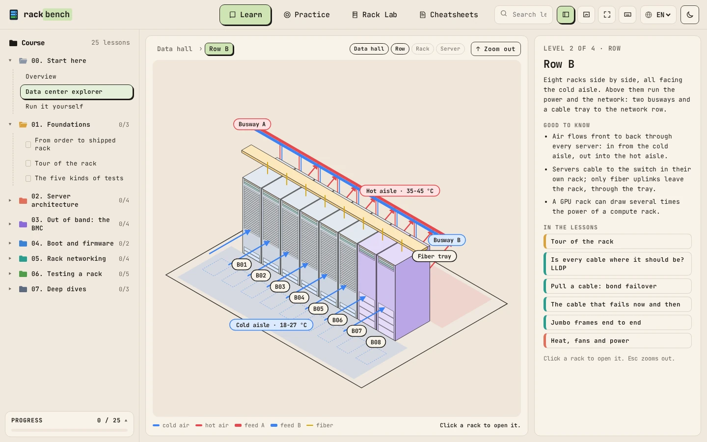
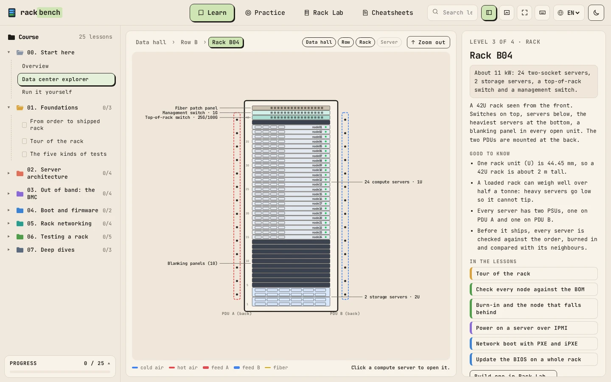
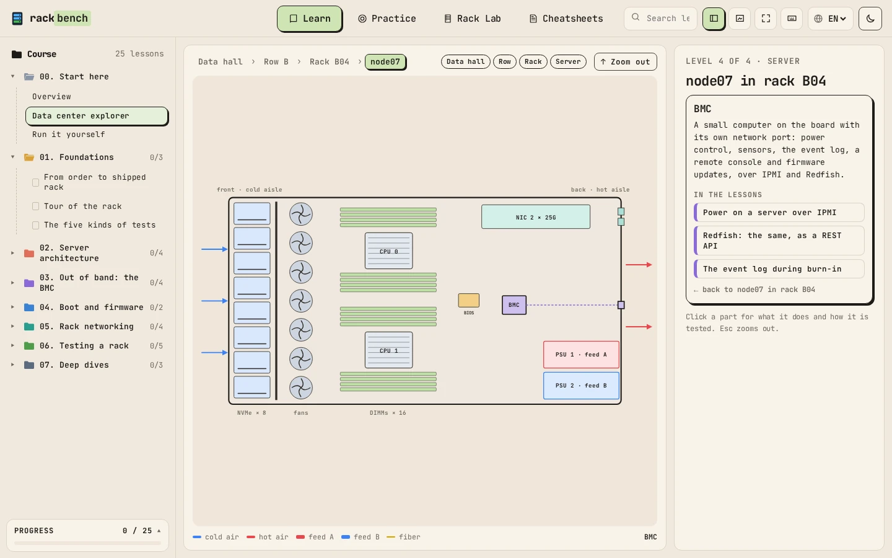
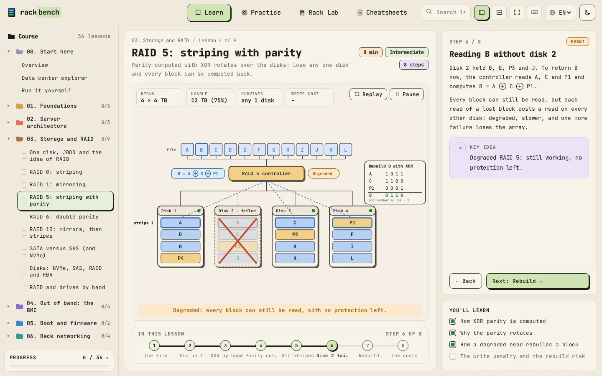

# Rackbench

**A data center rack, from order to shipping.**

Walk through the life of a data center rack: build it from the order, check every cable, power it on through the BMC, burn it in, find the failing part, write the report and ship it. In the browser you zoom into a data center, step through 36 animated lessons, play four games and drill with flashcards; then you do it for real on a three-node rack you run yourself.

**Live: https://rackbench.vercel.app**



## What you can do

- **Explore a data center.** Zoom from the data hall (rows of racks, hot and cold aisles with containment, CRAH cooling units, UPS and batteries, overhead busways, a staging area) into one row, one rack and one server with the lid off. Every part says what it does and how it is tested, and opens the lessons about it.
- **Learn.** 36 lessons in nine chapters, from what is inside a two-socket server to GPU racks: Foundations, Server architecture, Storage and RAID, Out of band (the BMC), Boot and firmware, Rack networking, Testing a rack, Deep dives, Interview topics. A step-through lesson draws the devices as isometric blocks, sends each message along its route with a travelling packet, updates live metrics and explains every step with the decoded fields and the raw output. Each one has a Diagram, a Sequence and a Packets view, with Replay and Pause.
- **Play Rack Shift.** One shift on a rack integration floor, three orders: an edge rack, a storage rack and a GPU rack. For each one you build the rack by the placement rules, check every cable against the plan with LLDP, power it on and check every server against the order and the firmware baseline, burn it in and read the results against the test plan, fix and retest, then write the report with evidence and root cause and ship it. The faults change every shift, and QA shows you what you missed.
- **RAID, level by level.** One animated lesson per level: the file's blocks fly to their disks, parity is computed bit by bit with XOR, a disk fails, a degraded read and a rebuild play out. JBOD, RAID 0, 1, 5, 6 and 10, then SATA versus SAS (and NVMe) one difference at a time.
- **Interview topics.** Power per server and per rack (from the parts list to the rack power chart, feeds, phases and heat), Linux pipes built stage by stage with exit codes and a parallel loop over the nodes, and isolating an unreachable node from the bottom up.
- **Practice.** Build a server (parts into a 1U by the population table), RAID Rescue (ten arrays per shift: survive or lose, capacity, XOR rebuilds, pick the level), Pipe puzzle (build the Linux pipeline that answers the question), a fault hunt (one hidden fault, a terminal, the clock), a quiz of 58 questions in eight topics, and flashcards: interview questions, RAID, commands and every term, part by part.
- **Rack Lab.** Build a 24U rack freely and check it against the integration rules: redundant feeds, the 80% power rule, switches on top, heavy servers low, blanking panels.
- **Cheatsheets.** ipmitool, Redfish, inventory, burn-in, network, boot, drives and power, Windows and PowerShell, cabling: filterable, one click to copy.
- **Run it yourself.** 13 hands-on labs, step by step, on the real three-node rack of [rackbench-lab](https://github.com/adam-bouafia/rackbench-lab).

Every page fits one screen. Next to the search are buttons to hide the course, show the diagram only, go full screen and list the keyboard shortcuts. Search (Ctrl K) covers lessons and commands; the interface switches between English, French and Dutch (the lessons are in English); light and dark themes.

## Screenshots

| | |
|---|---|
|  |  |
| A lesson: IPMI power-on, packet by packet | Packets view: network boot as a capture tool shows it |
|  |  |
| Rack Shift, Build: the placement rules say what is wrong | Rack Shift, Burn-in: one drive 31% under the median |
|  |  |
| Dark theme: GPU servers, what changes | Rack Lab: free rack building with power checks |
|  |  |
| Data center explorer: the data hall | One row: cold aisle in front, hot aisle behind, power and fiber above |
|  |  |
| One rack: switches on top, servers, blanking panels, PDUs | One server with the lid off: every part clickable |

## The lab behind it

Every lesson has a counterpart in [rackbench-lab](https://github.com/adam-bouafia/rackbench-lab): three Ubuntu nodes on KVM that report like two-socket servers, emulated BMCs that answer IPMI and Redfish, OpenBMC firmware in QEMU, iPXE network boot, a rack-wide BIOS update drill and a fault injector with 11 faults. Rackbench shows how it works; the lab is where you do it.

The traces are illustrative and the numbers simulated. Not affiliated with any hardware vendor.

## Run it locally

Node.js 24.

```bash
npm install
npm run dev          # http://localhost:5173
npm run build        # static files in dist/
```

## Optional features

Their keys live in `.env.local` or in the Vercel project settings, never in git (`.gitignore` excludes every `.env` file). See `.env.example`.

- Ask the rack: a question box that sends the current lesson and step to a model through the Vercel AI Gateway (`api/ask.ts`). Build with `VITE_ASSISTANT=1`. On Vercel the function authenticates with the project's OIDC token; locally it uses `AI_GATEWAY_API_KEY` or the token that `vercel link` writes to `.env.local`. The function limits question length, answer length and requests per visitor; also set a spend limit for AI Gateway in the Vercel dashboard.
- Narration: `node scripts/narrate.ts` counts the characters of every lesson step and estimates the ElevenLabs credits; with `--yes` and `ELEVENLABS_API_KEY` set it writes MP3 files and a manifest to `public/audio/`, and the site offers a narration switch.

## Deploying

- Vercel: `vercel --prod` from this folder, or connect the repository in the Vercel dashboard. `vercel.json` holds the build settings.
- GitHub Pages: `.github/workflows/pages.yml` builds the static site without the assistant; it only runs when started by hand from the Actions tab.

## Keeping it in step with the lab

The fault-hunt simulator (`src/hunt/sim.ts`) and the faults of Rack Shift (`src/game/shift.ts`) mirror `lab/faults.sh` in [rackbench-lab](https://github.com/adam-bouafia/rackbench-lab), and the lessons quote its commands and file names. When a fault or a script changes there, update the simulator and the lessons here.



## Layout

```
src/engine/     lesson layouts (flow, widget, stage), isometric diagram (IsoStage), sequence view
src/lessons/    lesson list, step-through content (flows*.ts), its metrics and labels (extras.ts), stage lessons (stages.ts)
src/raid/       RAID model (layouts, survival), the animated array stage and the RAID lessons
src/stages/     the SATA/SAS, power and Linux-pipes stages
src/data/       quiz bank, flashcard decks, terms
src/widgets/    the interactive lessons
src/hunt/       the fault-hunt simulator and its terminal
src/game/       Rack Shift, Build a server, RAID Rescue, Pipe puzzle
src/explore/    the data center explorer: zoom levels, parts and drawings
src/pages/      overview, practice, quiz, flashcards, Rack Lab, cheatsheets, lab guide
src/i18n.ts     interface strings in English, French and Dutch
api/ask.ts      the assistant function
scripts/        the narration script
```

## License

MIT, see `LICENSE`. Font: JetBrains Mono (SIL Open Font License, `public/fonts/OFL.txt`).
