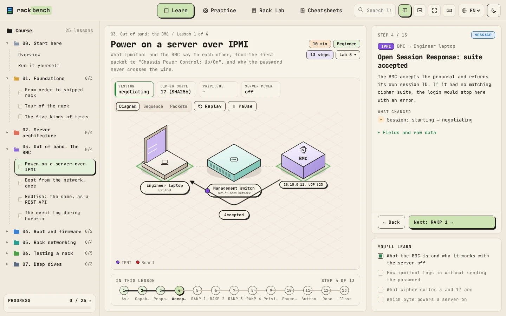
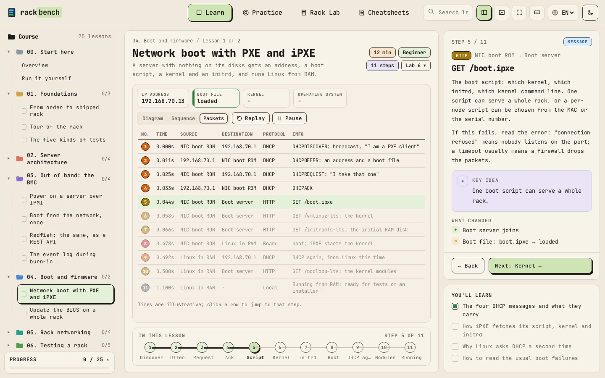
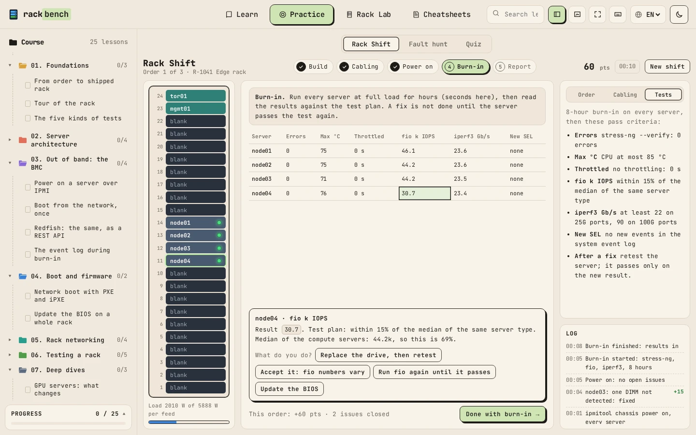
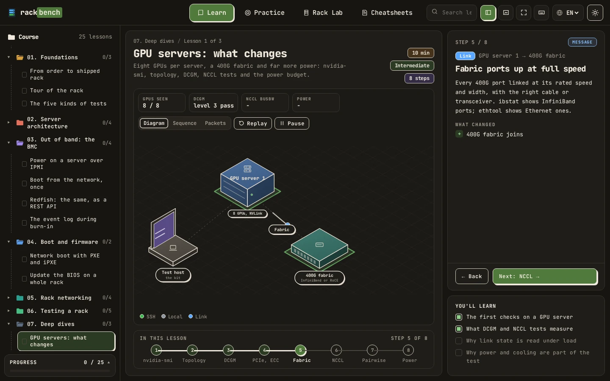

# Rackbench Explorer

An interactive site about how server racks are tested before they ship: BMCs, IPMI and Redfish, network boot, firmware updates, burn-in, network tests and fault finding. Live at https://rackbench.vercel.app



One screen, four sections:

- Learn: a course of 25 lessons in seven coloured chapters (Foundations, Server architecture, the BMC, Boot and firmware, Rack networking, Testing a rack, Deep dives), with progress kept in the browser. Step-through lessons show devices as isometric blocks that appear when they join the story, the current message as an arrow with a travelling packet, metrics that update per step, a stepper, and a side panel with the explanation, a key idea, what changed, the decoded fields and "You'll learn". New in the deep dives: disks and RAID, heat and power, LLDP cabling checks, writing a test script, Windows and PowerShell on the test bench, BIOS and OS tuning. Interactive lessons: the five kinds of tests, a rack tour with the cabling table, DIMM population and NUMA, PCIe link width, a BOM check, the burn-in outlier rule, jumbo frames, bond failover.
- Practice: Rack Shift, a game of one shift on a rack integration floor: three orders (edge, storage, GPU), and for each rack you build it by the placement rules, check every cable against the plan with LLDP, power it on and check each server against the order, burn it in and read the results against the test plan, fix and retest, then write the report with evidence and root cause and ship it. Faults are random per shift (`src/game/shift.ts`). Also a fault-hunt game (a simulated rack with one hidden fault and a terminal) and a 15-question quiz.
- Rack Lab: build a 24U rack and check it against integration rules: redundant feeds, the 80% power rule, switches on top, heavy servers low, blanking panels.
- Cheatsheets: ipmitool, Redfish, inventory, burn-in, network, boot, drives and power, Windows and PowerShell, cabling, and the rackbench lab commands, filterable, one click to copy.
- Overview: an animated map of the lab, the chapters with progress, and a table of what is real and what is emulated.
- Run it yourself: the setup and the 13 labs of the rackbench repository, one at a time.

Each step-through lesson has three views: the isometric diagram (the route draws itself, then a packet loops along it; Replay restarts the step, Pause freezes it), a sequence diagram, and a packet list in the style of a capture tool. The site opens straight into the first lesson, and every page fits the screen without scrolling (panels scroll inside); next to the search are buttons to hide the course, show the diagram only, go full screen and list the keyboard shortcuts. Search (Ctrl K) covers lessons and commands; the interface switches between English, French and Dutch (lesson texts are English); light and dark themes; JetBrains Mono throughout (SIL Open Font License, `public/fonts/OFL.txt`).

Every lesson has a hands-on counterpart in the lab: https://github.com/adam-bouafia/rackbench, a three-node rack on KVM with emulated BMCs, OpenBMC in QEMU, network boot and a fault injector.

The traces are illustrative and the numbers simulated. Not affiliated with any hardware vendor.

## Screenshots

| | |
|---|---|
|  |  |
| Overview: the animated lab map and the chapters | Packets view: network boot as a capture tool shows it |
|  |  |
| Rack Shift, Build: the placement rules say what is wrong | Rack Shift, Burn-in: one drive 31% under the median |
|  |  |
| Dark theme: GPU servers, what changes | Rack Lab: free rack building with power checks |

## Run it

Node.js 24.

```bash
npm install
npm run dev          # http://localhost:5173
npm run build        # static files in dist/
```

## Optional features

Their keys live in `.env.local` or in the Vercel project settings, never in git (`.gitignore` excludes every `.env` file). See `.env.example`.

- Ask the rack: a question box that sends the current lesson and step to a model through the Vercel AI Gateway (`api/ask.ts`). Build with `VITE_ASSISTANT=1`. On Vercel the function authenticates with the project's OIDC token; locally it uses `AI_GATEWAY_API_KEY` or the token that `vercel link` writes to `.env.local`. The function limits question length, answer length and requests per visitor; also set a spend limit for AI Gateway in the Vercel dashboard.
- Narration: `node scripts/narrate.ts` counts the characters of every lesson step and estimates the ElevenLabs credits; with `--yes` and `ELEVENLABS_API_KEY` set it writes MP3 files and a manifest to `public/audio/`, and the site offers a narration switch.

## Deploying

- Vercel: `vercel --prod` from this folder, or connect the repository in the Vercel dashboard. `vercel.json` holds the build settings.
- GitHub Pages: `.github/workflows/pages.yml` builds the static site without the assistant; it only runs when started by hand from the Actions tab.

## Keeping it in step with the lab

The fault-hunt simulator (`src/hunt/sim.ts`) mirrors the faults of `lab/faults.sh` in the rackbench repository, and the lessons quote its commands and file names. When a fault or a script changes there, update the simulator and the lessons here.

## Layout

```
src/engine/     lesson layout, isometric diagram (IsoStage), sequence view
src/lessons/    lesson list, step-through content (flows.ts, flows2.ts, flows3.ts) and its metrics and labels (extras.ts)
src/widgets/    the interactive lessons
src/hunt/       the fault-hunt simulator and its terminal
src/game/       Rack Shift: orders, faults and scoring (shift.ts), the screen (RackShift.tsx)
src/pages/      overview, practice and quiz, Rack Lab, cheatsheets, lab guide
src/i18n.ts     interface strings in English, French and Dutch
api/ask.ts      the assistant function
scripts/        the narration script
```

## License

MIT, see `LICENSE`.
